<div align="center">
  

  <h3>SocialCrawl Workflows</h3>
  <p>Ask your agent what went viral, what people say about a brand, or how a competitor's posts do. It reads the posts and hands back a finished report with the raw data.</p>

  <a href="https://github.com/socialcrawl/workflows/actions/workflows/check.yml"></a>
  <a href="LICENSE"></a>
</div>

---

```bash
npx skills add socialcrawl/workflows
```

Then ask your agent "what went viral about AI coding tools this week?". If you have no SocialCrawl key yet, the first run signs you in by email. A new account gets 100 free credits, no card, and every default run below fits inside them.

## Skills

Each skill runs one command of the [SocialCrawl CLI](https://github.com/socialcrawl/cli).

| Skill | Command | Give it | Get back | Default run, measured |
| --- | --- | --- | --- | --- |
| [`socialcrawl-workflows`](skills/socialcrawl-workflows/) | the one it picks | a question in plain words | the right skill below, run for you | the run it picks |
| [`socialcrawl-viral`](skills/socialcrawl-viral/) | `social-viral` | a topic | the posts that broke out this week on X, TikTok, Instagram, YouTube, Reddit and LinkedIn, each against its author's earlier posts | 61 credits |
| [`socialcrawl-pulse`](skills/socialcrawl-pulse/) | `social-pulse` | a brand or topic | what changed this week against the week before: on-topic posts, sentiment, questions, complaints, and the posts breaking out | 43 credits |
| [`socialcrawl-presence`](skills/socialcrawl-presence/) | `social-presence` | a brand's or public figure's name, and its website | its accounts on six platforms, each confirmed by a link or marked as not confirmed, with how active each is | 23 credits |
| [`socialcrawl-tiktok-marketing`](skills/socialcrawl-tiktok-marketing/) | `tiktok-marketing` | a keyword | the TikTok videos breaking out on it against their creators' earlier videos, with their lengths, hooks, sounds and what the comments ask | 38 credits |
| [`socialcrawl-instagram-marketing`](skills/socialcrawl-instagram-marketing/) | `instagram-marketing` | a keyword | the Instagram reels breaking out on it against their creators' earlier reels, with their lengths, hooks and what the comments ask | 39 credits |
| [`socialcrawl-youtube-marketing`](skills/socialcrawl-youtube-marketing/) | `youtube-marketing` | a keyword | the YouTube videos and Shorts breaking out on it against their channels' earlier uploads, with their lengths, titles and what the comments ask | 34 credits |
| [`socialcrawl-linkedin-marketing`](skills/socialcrawl-linkedin-marketing/) | `linkedin-marketing` | a keyword | the LinkedIn posts breaking out on it against their authors' earlier posts on likes, the companies and members posting most, and what the comments ask | 48 credits |
| [`socialcrawl-x-marketing`](skills/socialcrawl-x-marketing/) | `x-marketing` | a keyword | the X posts breaking out on it against their authors' earlier posts, who retweeted and quoted the top ones, which look boosted, and what the replies ask | 36 credits |
| [`socialcrawl-competitor-research`](skills/socialcrawl-competitor-research/) | `competitor-research` | two to five brands | each brand's share of the posts read per platform, its best post against its author's usual reach, and what its audience asks and complains about | 48 credits |
| [`socialcrawl-post-tracker`](skills/socialcrawl-post-tracker/) | `post-tracker` | a post link | its views, likes, comments and quotes now and at every later reading, against its author's usual reach, with a chart | 2 to 5 credits, then 1 a reading |
| [`socialcrawl-video-teardown`](skills/socialcrawl-video-teardown/) | `video-teardown` | a video link | how it did against its creator's earlier videos, a storyboard of what is on screen and said, its words, sound and comments | 7 to 29 credits, by platform |
| [`socialcrawl-reddit-marketing`](skills/socialcrawl-reddit-marketing/) | `reddit-marketing` | a keyword | the threads that beat their community, what people ask, each community's rule on promotion, and where a disclosed reply would help | 28 credits |
| [`socialcrawl-teardown`](skills/socialcrawl-teardown/) | `social-teardown` | an account, or several handles of one brand | the posts that broke out against its own, what its top posts share, its launches, who carried them, what people ask, and where it sends people | 74 credits |

Each cost was measured on 27/11/2026 with nothing cached; each skill's page gives the input and the request ids. `--deep` reads more and costs more, and the run says how much before it starts.

## What you get back

Every card below comes from a real run on 27/11/2026. Click one for its full report.

<table>
<tr>
<td width="50%" valign="top"><a href="skills/socialcrawl-viral/examples/report.md">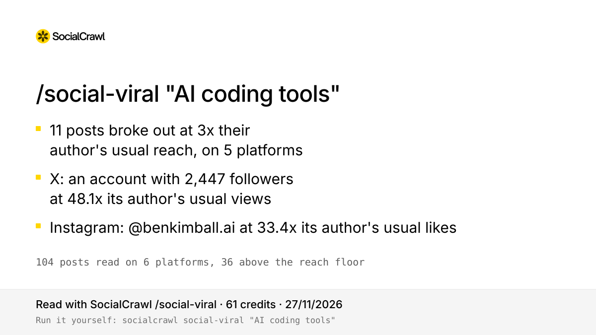</a><br><b>social-viral</b> "AI coding tools": 11 posts broke out at 3x their author's usual reach, on 5 platforms. The largest, on X, at 48.1x.</td>
<td width="50%" valign="top"><a href="skills/socialcrawl-pulse/examples/report.md">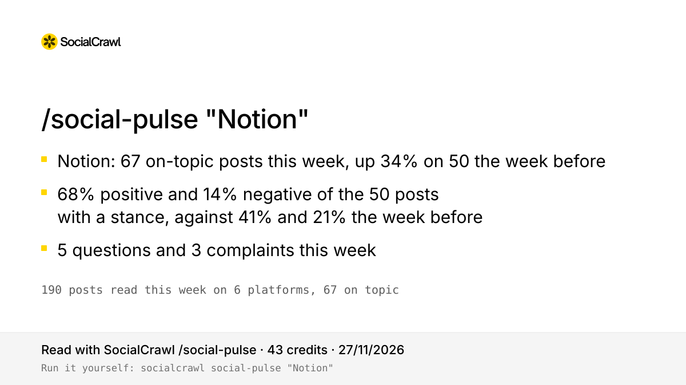</a><br><b>social-pulse</b> "Notion": 67 on-topic posts this week, up 34%, and 68% positive against 41% the week before.</td>
</tr>
<tr>
<td valign="top"><a href="skills/socialcrawl-presence/examples/report.md"></a><br><b>social-presence</b> "Linear": 2 accounts confirmed by a link, on LinkedIn and X, and 1 judged the same without one.</td>
<td valign="top"><a href="skills/socialcrawl-competitor-research/examples/report.md">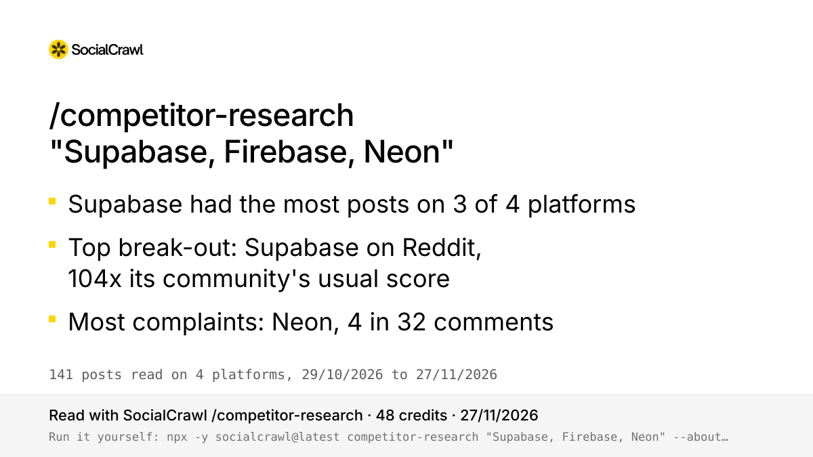</a><br><b>competitor-research</b> "Supabase, Firebase, Neon": Supabase had the most posts on 3 of 4 platforms, and the largest break-out, 104x its community's usual score on Reddit.</td>
</tr>
<tr>
<td valign="top"><a href="skills/socialcrawl-tiktok-marketing/examples/report.md">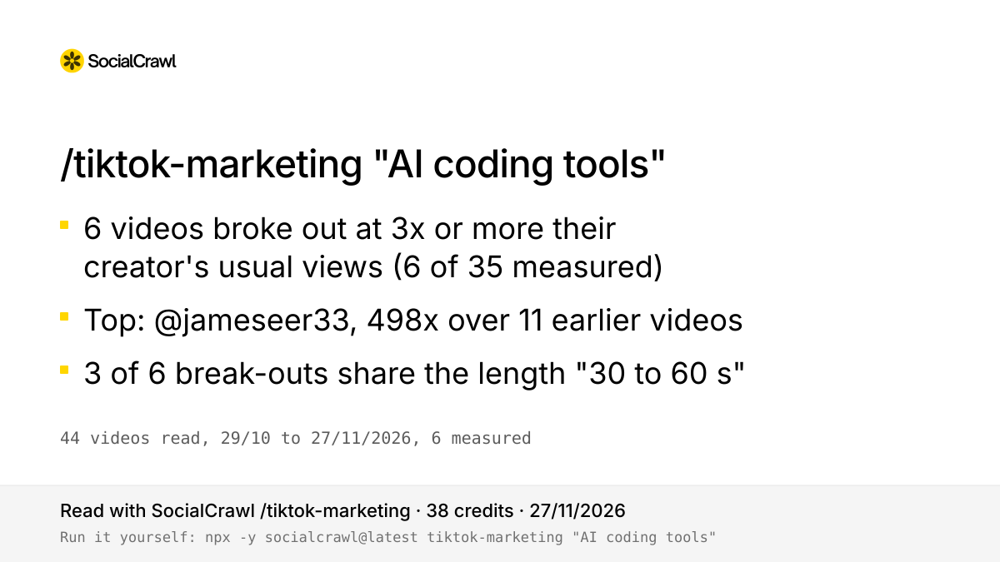</a><br><b>tiktok-marketing</b> "AI coding tools": all 6 videos it could measure broke out, the largest at 498x its creator's usual views.</td>
<td valign="top"><a href="skills/socialcrawl-instagram-marketing/examples/report.md">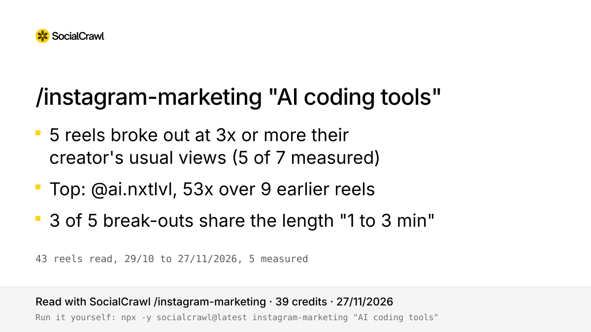</a><br><b>instagram-marketing</b> "AI coding tools": all 5 reels it could measure broke out, the largest at 53x its creator's usual views.</td>
</tr>
<tr>
<td valign="top"><a href="skills/socialcrawl-youtube-marketing/examples/report.md">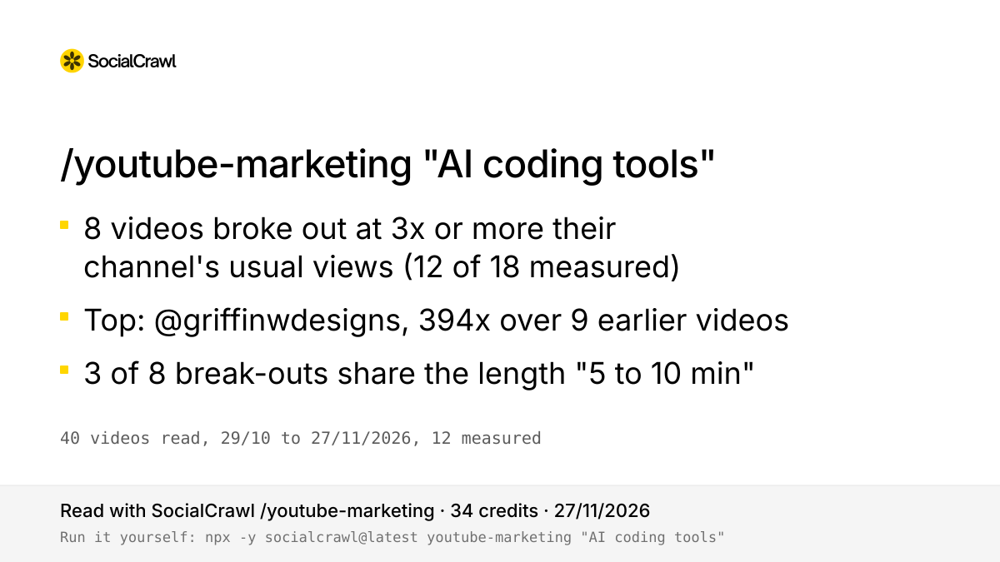</a><br><b>youtube-marketing</b> "AI coding tools": 8 of 12 measured videos broke out, the largest at 394x its channel's usual views.</td>
<td valign="top"><a href="skills/socialcrawl-x-marketing/examples/report.md">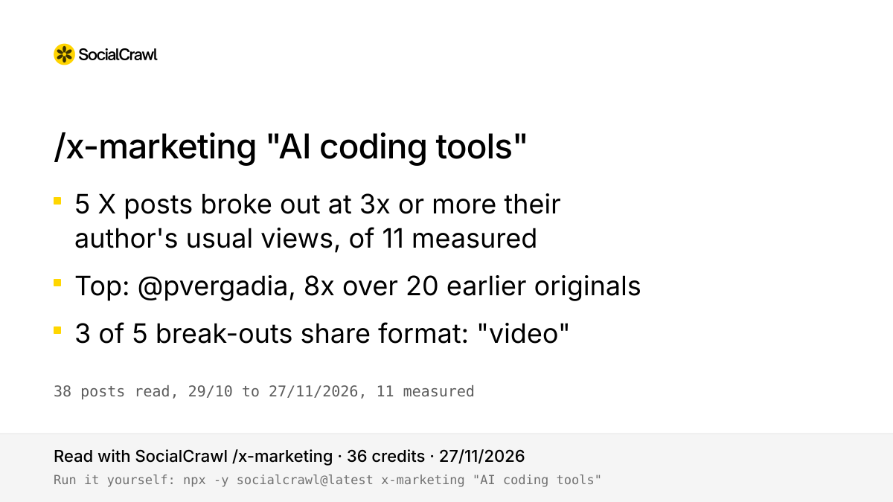</a><br><b>x-marketing</b> "AI coding tools": 5 of 11 measured posts broke out, the largest at 8x its author's usual views.</td>
</tr>
<tr>
<td valign="top"><a href="skills/socialcrawl-linkedin-marketing/examples/report.md">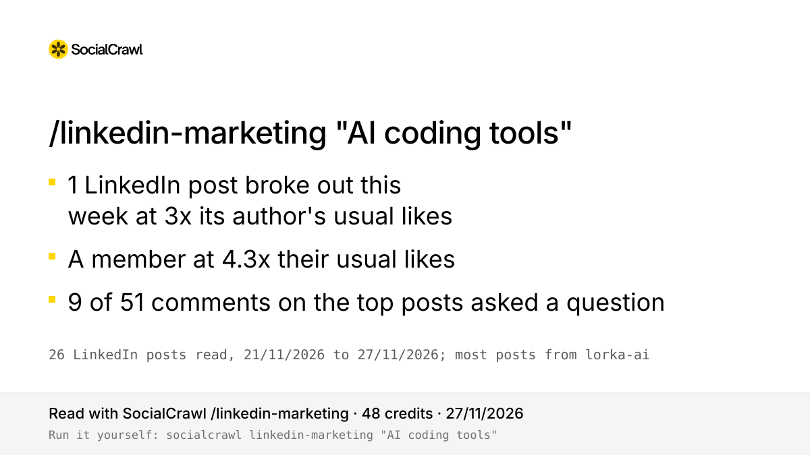</a><br><b>linkedin-marketing</b> "AI coding tools": 1 post broke out at 4.3x its author's usual likes, and 9 of the 51 comments read are phrased as questions.</td>
<td valign="top"><a href="skills/socialcrawl-post-tracker/examples/report.md">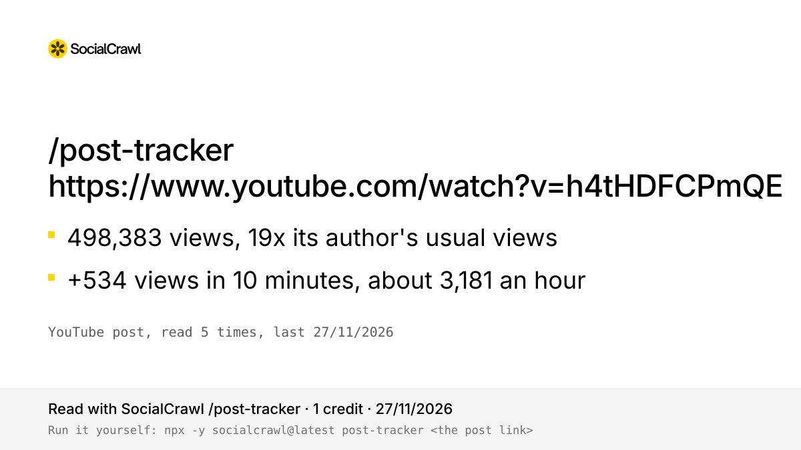</a><br><b>post-tracker</b> on an IBM Technology video: 19x its channel's usual views, gaining about 3,181 views an hour.</td>
</tr>
<tr>
<td valign="top"><a href="skills/socialcrawl-video-teardown/examples/report.md">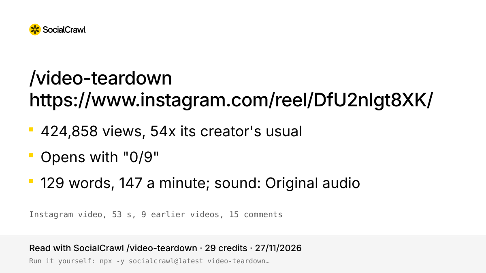</a><br><b>video-teardown</b> on an Instagram reel: 54x its creator's usual views, with a storyboard of what is on screen second by second.</td>
<td valign="top"><a href="skills/socialcrawl-teardown/examples/report.md">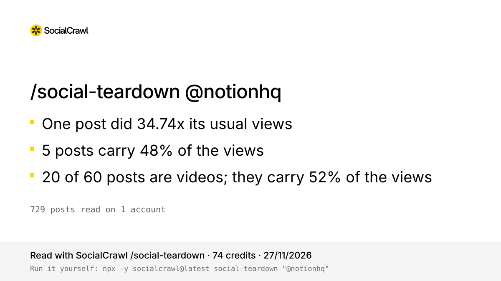</a><br><b>social-teardown</b> "@notionhq": 5 of its 60 own posts broke out, the largest at 34.7x its usual views, and together they carry 48% of the views.</td>
</tr>
<tr>
<td valign="top"><a href="skills/socialcrawl-reddit-marketing/examples/report.md">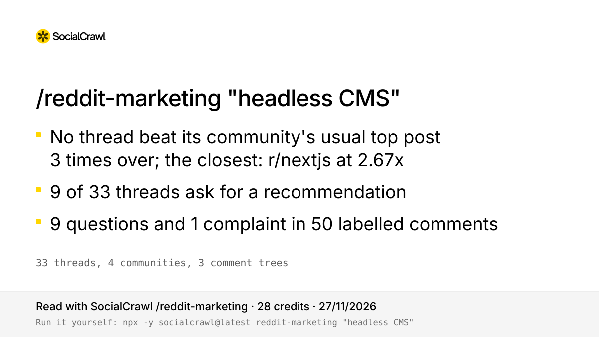</a><br><b>reddit-marketing</b> "headless CMS": no thread beat its community's usual top post 3 times over, the closest at 2.67x in r/nextjs, and 9 of 33 threads asked for a recommendation.</td>
</tr>
</table>

## Install

| You want | Run |
| --- | --- |
| Every skill, in the agents you pick | `npx skills add socialcrawl/workflows` |
| One skill | `npx skills add socialcrawl/workflows --skill socialcrawl-viral` |
| Your key and the skills in one step | `npx -y socialcrawl@latest init` |
| The Claude Code plugin | `/plugin marketplace add socialcrawl/workflows` |

On its first run a skill asks for your email, never your key, and gives you a link and a 6-digit code to sign in. `npx skills update` brings the latest versions.

## Where each part lives

| Repository | What it is | Install |
| --- | --- | --- |
| [socialcrawl/workflows](https://github.com/socialcrawl/workflows) | These skills, one per research task, each named `socialcrawl-<task>` | `npx skills add socialcrawl/workflows` |
| [socialcrawl/cli](https://github.com/socialcrawl/cli) | The `socialcrawl` command the skills run: the API calls, the scoring and the report | `npx -y socialcrawl@latest` |
| [socialcrawl/skills](https://github.com/socialcrawl/skills) | The API skill, `socialcrawl`: raw data from any endpoint, one call at a time | `npx skills add socialcrawl/skills` |
| [socialcrawl/mcp](https://github.com/socialcrawl/mcp) | The MCP server, for agents that call tools | see its README |

The workflow skills and the API skill install side by side. No two share a name, and CI fails a skill here whose name `socialcrawl/skills` or `socialcrawl/mcp` already uses.

## How a run works

Ask in plain words (`/socialcrawl-workflows what went viral in AI coding tools this week?`), or run one in a terminal:

```bash
npx -y socialcrawl@latest social-viral "AI coding tools"
```

The run prints its price, then runs, with no approval step. If your balance cannot cover all of it, it reads what the balance covers, says what it left out, and links to a top-up. Then it writes a run folder:

| File | What is in it |
| --- | --- |
| `report.html` | The report with charts, one page, works offline |
| `report.md` | The same report as text, for your agent or a doc |
| `card.svg` | A 1200 × 675 card with the headline numbers, like the ones above |
| `data/*.csv` | Every row it read, so you keep the raw data |
| `responses.jsonl` | Every API response, with its request id |
| `evidence.json` | Each claim and the requests behind it |

Every number links back to the request that produced it, and the report has a section on what it could not read and why.

## What it never does

- It never posts, likes, follows, comments or messages. It only reads public posts.
- It never names an account under 10,000 followers, unless it is a company, a founder, a verified account or the one you asked about. It describes the account instead, and your own `data/` keeps every row.
- It never takes your key in the chat, and never prints it.
- It names no data supplier. Every number comes from the SocialCrawl API and carries its request id.
- It never adds a number the run did not read. A count it could not read is shown as unknown, not zero.

## Contributing

See [CONTRIBUTING](https://github.com/socialcrawl/.github/blob/main/CONTRIBUTING.md). Each skill lives in `skills/socialcrawl-<task>/` with a `SKILL.md`, a `README.md` and an example run in `examples/`; `node scripts/check.mjs` checks them. The workflows run on the [SocialCrawl CLI](https://github.com/socialcrawl/cli), where their code and tests live.

## Licence

MIT
