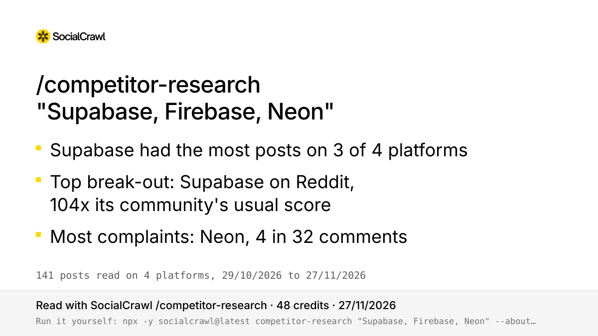

# competitor-research

Give it two to five brands and their category. It reads what was posted about each on X, TikTok, YouTube and Reddit in the last 30 days and tells you:

- each brand's share of the posts read and of their reach, per platform;
- each brand's best post per platform, measured against its author's usual reach;
- what each brand's audience asks and complains about, quoted;
- on a deep run, each brand's own ads in the TikTok ad library.

It only reads data, and never posts, likes, follows or comments for you.

## Install

```bash
npx -y socialcrawl@latest init
```

`init` asks for your SocialCrawl key, or signs you in by email (100 free credits, no card), and installs the skill into the agents it finds. Then ask your agent "compare Notion, Obsidian and Logseq on social", or run it in a terminal:

```bash
npx -y socialcrawl@latest competitor-research "Notion, Obsidian, Logseq" --about "note-taking apps"
```

Always give the category with `--about`: each brand is searched with a filter that keeps only posts about that brand in that category, so "Neon" the database is not counted for neon signs. It reads the last 30 days unless you pass `--since` and `--until`.

## Example

`competitor-research "Supabase, Firebase, Neon" --about "backend and database platforms for app developers"`, run on 27/11/2026:



The full report is in [examples/report.md](examples/report.md). In short, over 29/10 to 27/11/2026: Supabase had the most posts read on 3 of the 4 platforms. Neon had the fewest X posts but 80% of the X reach, and the table shows why that share is fragile: one post holds 49% of it. Each brand's most-reached post was measured against its author's earlier posts; the largest break-out was a Reddit thread about Supabase at 104 times its community's usual score. Neon's audience left the most complaints, 4 in 32 comments read.

The example names only accounts with 10,000 followers or more and never a Reddit member; your own run keeps every link in `data/posts.csv`.

## What it costs

| Run | Reads | Credits, three brands |
| --- | --- | --- |
| Default | one search per brand on X, TikTok, YouTube and Reddit, each brand's best post per platform measured, comments on those posts | 48 measured, quoted at about 56, at most 98 |
| `--deep` | two pages per search, Instagram too, Reddit comment threads, each brand's TikTok ads | quoted at about 112, at most 239; not yet measured |

More brands cost more: each adds about a third. The run prints its price, then runs. If your balance is short, it reads what the balance covers and says what it left out.

Measured 27/11/2026 on "Supabase, Firebase, Neon", 29/10 to 27/11/2026, uncached: default 48 credits, 30 calls, 104 s (req-FikgDh8syGfwFqF5 to req-MS1zwV4aPlrteEo2).

## How it counts

Share of voice here is not a count of everything said. For each brand on each platform the run reads one page of the platform's top posts for the brand's name, keeps the posts the topic filter judges to be about that brand in its category, and shares them out: share of posts, and share of their views (score on Reddit). Shares are never added across platforms. A post about two brands counts for both. Each brand's best post per platform is divided by the median reach of its author's 8 to 20 earlier comparable posts (on Reddit, the median score of its community's top posts of the month); 3 times or more is a break-out.

## What it cannot read

- Everything said: only the top page of each platform's search is read, so a share is of the posts read.
- The filter's mistakes: it can keep an off-topic post or drop a real one; read `data/posts.csv` before you quote a share.
- Ads in a default run, and ads under any other advertiser name: the TikTok ad library's name search returns other advertisers, which the run leaves out and counts.
- Meta and LinkedIn ads: their name searches matched other companies when tested, so they are not read.
- Instagram in a default run: its search takes about 26 seconds a page.

## What it calls

SocialCrawl's API only (`twitter/search/tweets`, `tiktok/search`, `youtube/search`, `reddit/search`, `twitter/tweet/replies`, `tiktok/profile/videos`, `tiktok/post/comments`, `youtube/channel/videos`, `youtube/channel/shorts`, `youtube/channels`, `youtube/video/comments`, `reddit/subreddit`, and on `--deep` `instagram/search/reels`, `reddit/post/comments`, `tiktok/adlibrary/search`), with your key. No other service.

## Code

The workflow's code and tests are in [socialcrawl/cli](https://github.com/socialcrawl/cli) under `src/workflows/competitor-research/`.
