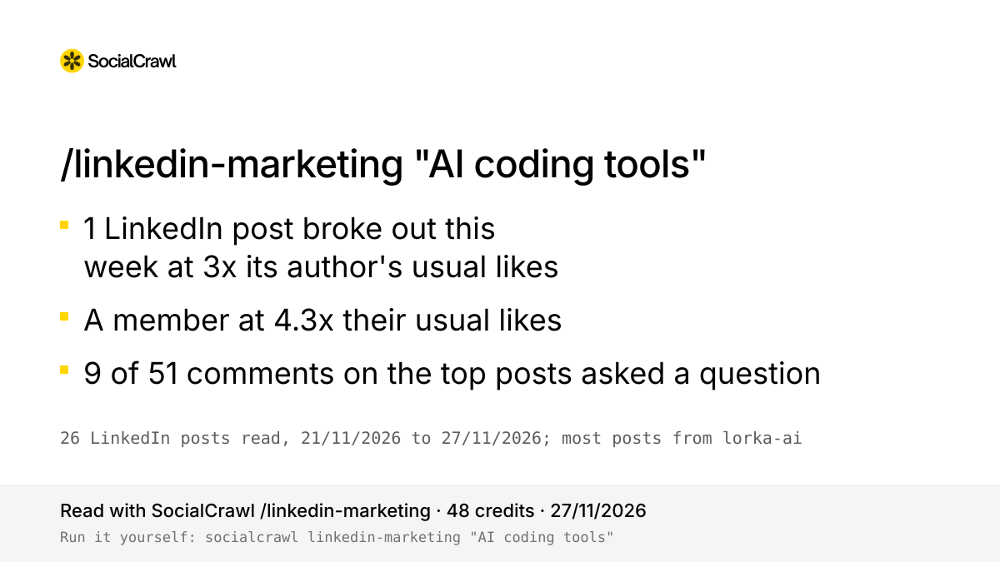

# linkedin-marketing

Give it a keyword. It reads this week's LinkedIn posts on it and tells you:

- which members' posts broke out, each measured against the same member's earlier posts on likes;
- which companies and members post most about it;
- what the comments on the most liked posts ask;
- what LinkedIn does not give, and what the run could not read.

It reads only. It never posts, reacts, connects or comments for you.

## Install

```bash
npx -y socialcrawl@latest init
```

`init` asks for your SocialCrawl key, or signs you in by email (100 free credits, no card), and installs the skill into the agents it finds. Then ask your agent "what's working on LinkedIn for AI coding tools this week?", or run it in a terminal:

```bash
npx -y socialcrawl@latest linkedin-marketing "AI coding tools"
```

If your keyword means something else outside your field, add one sentence: `--about "AI coding tools for software developers"`. Only posts about that are kept.

## Example

`linkedin-marketing "AI coding tools" --about "AI coding tools for software developers"`, run on 27/11/2026 for 21/11 to 27/11/2026:



The full report is in [examples/report.md](examples/report.md). In short: of 26 posts read, 1 broke out at 3 times or more its author's usual likes, a member's post at 4.3x (45 likes against a median of 11 over 10 earlier posts). One company posted on the keyword that week; 25 members posted the rest. 9 of the 51 comments read on the two most liked posts were phrased as questions, among them "Where do your developers live?" and "So why even need the subscription when you could build models with recursive memory?"

The example names companies only. LinkedIn's post search gives no follower counts, so members are described, not named; your own run keeps every row in `data/`.

## What it costs

| Run | Reads | Credits |
| --- | --- | --- |
| Default | three pages of the week's posts with the topic filter, up to 5 members' earlier posts, the comments of the 2 most liked posts | 48 measured, quoted at about 53, at most 74 |
| `--deep` | six pages of the month's posts, up to 10 members' earlier posts, the same comments | quoted at about 96, at most 138; not yet measured |

The run prints its price, then runs. If your balance is short, it reads what the balance covers and says what it left out.

Measured 27/11/2026 on "AI coding tools", uncached: default 48 credits, 7 calls, 36 s (req-dYoCulwkm9k1uiFQ to req-KRcauvKBD9uUIzua). Three earlier runs that day cost 53 credits each, 8 calls, about 20 s.

## How it measures a post

A member's post is measured when it has 20 likes or more. Its likes are divided by the median likes of the same member's 8 to 20 earlier posts, the post itself left out. Under 8 earlier posts it gives no number. 3 times or more is a break-out; 1.5 times is above usual. Earlier posts cost 5 credits a member, so the default run measures up to 5 members, the most liked first.

## What it cannot read

- Views: LinkedIn gives none, so posts are compared on likes.
- Follower counts: LinkedIn's post search gives none, so a member is described, not named.
- A company's own earlier posts: they need a numeric id the post search does not give, so company posts are counted but not measured, and the report says how many.
- Labels on comments: a question is a comment phrased as one.
- Members past the run's share for earlier posts: their posts are listed without a multiple, and the report says how many.
- Whether a post was promoted: LinkedIn does not say.

## What it calls

SocialCrawl's API only (`linkedin/search/posts`, `linkedin/profile/posts`, `linkedin/post/comments`), with your key. No other service.

## Code

The workflow's code and tests are in [socialcrawl/cli](https://github.com/socialcrawl/cli) under `src/workflows/linkedin-marketing/`.
