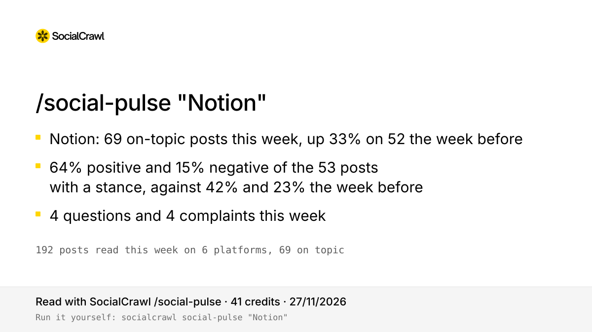

# social-pulse

Give it a brand or a topic. It reads this week's posts about it on X, Reddit, TikTok, Instagram, YouTube and LinkedIn, reads the week before the same way, and tells you:

- how many posts were on topic, and the change from the week before;
- the share that was positive and negative, and what it was the week before;
- how many posts asked a question, complained, recommended it, talked about switching or sold something;
- the questions people asked, quoted;
- which posts broke out against their author's own earlier posts.

It reads only. It never posts, likes, follows or comments for you.

## Install

```bash
npx -y socialcrawl@latest init
```

`init` asks for your SocialCrawl key, or signs you in by email (100 free credits, no card), and installs the skill into the agents it finds. Then ask your agent "what are people saying about Notion this week?", or run it in a terminal:

```bash
npx -y socialcrawl@latest social-pulse "Notion" --about "Notion, the notes and docs app"
```

If the name has another meaning, the `--about` sentence keeps only the posts about what you mean.

## Example

`social-pulse "Notion"`, run on 27/11/2026 for 21/11 to 27/11/2026 against 14/11 to 20/11/2026:



The full report is in [examples/report.md](examples/report.md). In short: 67 posts were on topic this week, up 34% on 50 the week before, out of 190 read. 68% of the 50 posts with a stance were positive and 14% negative, against 41% and 21% the week before. There were 5 questions against none, and 23 posts selling something against 8. The largest break-out was a TikTok video from @gwen.ignacioo at 10.7x its usual views: 18,479 views against a median of 1,725 over its 16 earlier videos.

## What it costs

| Run | Reads | Credits |
| --- | --- | --- |
| Default | one search a platform for each of the two weeks, with stance and intent labels; the earlier posts of this week's posts above the reach floor, inside a small share a platform; the size of each break-out's account the search left out | 43 measured, quoted at about 77, at most 100 |
| `--deep` | two pages a platform each week, and 2.5 times the share of earlier posts | quoted at about 162, at most 232; not yet measured |

Each week's read is quoted for free first, and sent with the least ceiling that quote allows. If what is left of the run's budget no longer covers the week before, the run reads this week alone and says so.

Measured 27/11/2026 on "Notion", uncached: default 43 credits, 10 calls, 77 s (req-4ZPjfSpNc1VPblrx to req-9pKXcEB5MwAelpbc).

## How it reads a week

Each week is one search a platform for the same words. A post is kept when it is judged to be on topic, and each kept post gets a stance (positive, negative, neutral, uncertain) and an intent (question, complaint, recommendation, switching, selling). A share of positive or negative posts is given only from 10 posts with a stance. A post breaking out is one at 3 times or more the median of its author's comparable earlier posts, over at least 8 of them, read only for posts above each platform's reach floor.

## What it cannot read

- Every post on the platforms: the counts are of the posts one search a platform returned each week, so a change compares like with like, not totals.
- Break-outs on LinkedIn: its authors' earlier posts cost 5 credits each, so a pulse leaves them to `social-viral`.
- Kept posts beyond the first 100 of a week: they are counted in the totals, not listed.
- How sure each label is: stance and intent are judged on each post, and the raw labels are in `data/posts_this_week.csv` for you to check.

## What it calls

SocialCrawl's API only (`prism/discover`, with its free dry run, then the earlier posts of break-out candidates through `tiktok/profile/videos`, `instagram/profile/reels`, `youtube/channel/videos`, `twitter/search/tweets`, `reddit/subreddit`, and `youtube/channel` or `instagram/profile` for an account's size), with your key. No other service.

## Code

The workflow's code and tests are in [socialcrawl/cli](https://github.com/socialcrawl/cli) under `src/workflows/social-pulse/`.
