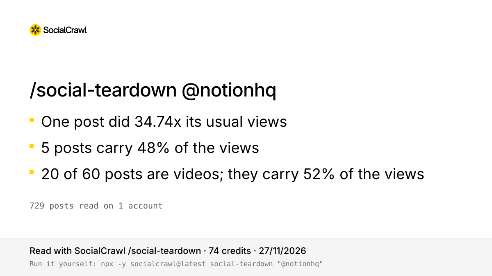

# social-teardown

Give it an account, or several handles of one brand. It reads the account's public posts and tells you:

- which posts broke out, each measured against the account's own earlier posts, and how much of the reach they carry;
- what the top third of its posts has that the bottom third lacks, and how much of the reach its videos carry;
- when it posts, and on X its launches: what it announced, at what hour, and how often it announced the same thing again;
- who carried the top posts on X: who reposted, who quoted in the first hour, who posted about each launch, and who replied under several posts;
- what people ask and complain about in the comments, quoted;
- the opening words of its videos, and where its bio and posts send people.

It works on X, TikTok, Instagram, YouTube, LinkedIn, Reddit and Threads. It reads only. It never posts, follows, likes or replies.

## Install

```bash
npx -y socialcrawl@latest init
```

`init` asks for your SocialCrawl key, or signs you in by email (100 free credits, no card), and installs the skill into the agents it finds. Then ask your agent "how does @notionhq grow on X?", or run it in a terminal:

```bash
npx -y socialcrawl@latest social-teardown @notionhq
npx -y socialcrawl@latest social-teardown "tiktok:notionhq ig:notionhq yt:@Notion"
```

Name an account as `@handle` (X), `tiktok:name`, `ig:name`, `yt:@name`, `threads:name`, `reddit:u/name`, or paste its profile link. LinkedIn needs the link: `linkedin.com/company/<name>` or `linkedin.com/in/<name>`.

## Example

`social-teardown @notionhq`, run on 27/11/2026:



The full report is in [examples/report.md](examples/report.md). In short: the run read 729 posts. 60 are Notion's own posts and 36 more quote another post. 5 of the 60 broke out, three times or more their earlier posts' median, and together they carry 48% of the views; the largest did 34.7 times its usual views. The 20 videos carry 52% of the views, and posts with no link are more common in the top third than in the bottom third (62% against 15%).

The same brand on TikTok, Instagram and YouTube in one run is in [examples/brand/report.md](examples/brand/report.md). It also shows the flag for a post whose views run far ahead of its likes, as promoted posts do: one YouTube video had 0.01 likes per 1,000 views against the channel's median of 8.85.

A run folder also holds `report.html` with charts, `data/` with every post read as CSV, and `responses.jsonl` with every API response.

## What it costs

| Run | Reads | Credits | Time |
| --- | --- | --- | --- |
| Default | the recent history: the newest posts and month by month back until its share runs out; on X the reposters, replies, first-hour quotes and launch posts around the top posts | 74 measured on one account, quoted at about 83, at most 100, shared by all the accounts named | about 4 to 5 minutes |
| `--deep` | the whole history from the join date, more top posts, more pages of each, Reddit and Hacker News echo of the top launches | 438 measured, quoted at about 493, at most 600 | about 20 minutes |

The run prints its price, then runs. If your balance is short, it reads what the balance covers and says what it left out.

Measured 27/11/2026, uncached: `@notionhq` default 74 credits, 38 calls, 300 s (req-NbKSskkO5zqHQDI1 to req-uWTVl6xNkpo4dlRR); `tiktok:notionhq ig:notionhq yt:@Notion` default 66 credits, 19 calls, 191 s (req-YpUkFjUipLQWApCB to req-aDNOHTJDw23cJ3bS); `@notionhq --deep` 438 credits, 96 calls, 19 minutes, 590 posts read (req-ZesaDMwPTaIwXrpb to req-BaNrEJpNS5Z7foJP).

## How it measures a post

A post's views (likes where a platform counts no views, points on Reddit) over the median of the same account's 20 earlier comparable posts, videos with videos. Under 8 such posts it gives no number. 3 times or more is a break-out. Top against bottom is the top third by that multiple against the bottom third, only with 24 posts or more and only when a trait shows up 15 points more often in the top third.

Every sentence in the report says whether it was seen, inferred or unknown, and cites the request it came from. Accounts are named only when they are the account read or have more than 10,000 followers; everyone else is counted or described. Early quotes and repeat repliers are reported as counts and minutes; the report does not say anyone arranged them.

## What it cannot read

- Whom an X post quotes, on rows the API returned before it added the quoted post (27/11/2026): such text posts are counted as possible quotes.
- Quotes after a post's first hour (three hours with `--deep`), and posts about a launch after its first hour (two with `--deep`). X search reads newest first, so a read can stop before the start of its window; the report says where each read stopped.
- Follower growth over time: platforms give today's count only.
- Who shared a post on TikTok, Instagram, YouTube or LinkedIn: those platforms do not show it.
- Adverts: a promoted post's views count as views. The report flags views far ahead of likes, and says that is inferred.
- Transcripts of music-only videos on TikTok, Instagram and YouTube can come back with words nobody spoke. The report says so beside each of those transcripts.

## Credit

The investigation method, every conclusion marked observed, inferred or unknown with the evidence behind it, is adapted from [REA, Reverse Engineer Anything](https://github.com/morluto/rea) (MIT, Copyright (c) 2026 morluto). This project is not affiliated with REA.

## What it calls

Only the SocialCrawl API: on X `twitter/profile`, `twitter/user/tweets`, `twitter/search/tweets`, `twitter/tweet`, `twitter/tweet/retweeters`, `twitter/tweet/replies`, `twitter/tweet/transcript`, `github/repo` and, with `--deep`, `reddit/search` and `prism/launch-echo`; elsewhere each platform's profile, posts, comments and transcript reads. The code is in [socialcrawl/cli](https://github.com/socialcrawl/cli/tree/main/src/workflows/social-teardown).
