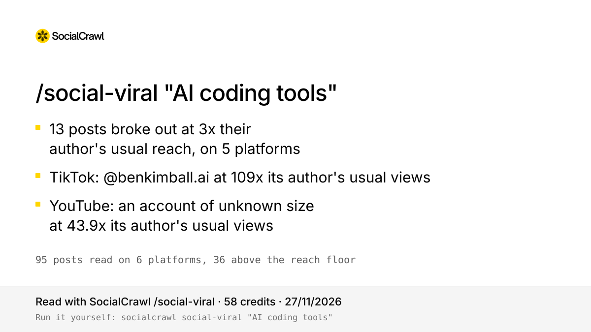

# social-viral

Give it a topic. It reads this week's posts on it on X, TikTok, Instagram, YouTube, Reddit and LinkedIn and tells you:

- which posts broke out, each measured against its own author's earlier posts, not raw views;
- which platforms they came from, and how many posts each platform gave;
- which break-outs are still rising, and which carry a flag worth checking;
- what will not copy for your account, and the next things to run;
- what it could not read, and why.

It reads only. It never posts, likes, follows or comments for you.

## Install

```bash
npx -y socialcrawl@latest init
```

`init` asks for your SocialCrawl key, or signs you in by email (100 free credits, no card), and installs the skill into the agents it finds. Then ask your agent "what went viral about AI coding tools this week?", or run it in a terminal:

```bash
npx -y socialcrawl@latest social-viral "AI coding tools"
```

If your topic means something else outside your field, add one sentence: `--about "AI tools that write and review code for software developers"`. Only posts about that are kept.

## Example

`social-viral "AI coding tools"`, run on 27/11/2026 for 20/11 to 27/11/2026:



The full report is in [examples/report.md](examples/report.md). In short: 11 posts broke out at 3 times or more their author's usual reach, on 5 of the 6 platforms, out of 36 above the reach floor among 104 posts read. The largest was an X post from an account with 2,447 followers, at 48.1x: 46,493 views against a median of 967 over its 20 earlier posts. The report describes that account rather than naming it, since it is under 10,000 followers. Next came an Instagram reel from @benkimball.ai at 33.4x, still rising when it was read. None of LinkedIn's 9 posts passed its reach floor. A run folder also holds `report.html` with a chart, `data/` with every post as CSV, and `responses.jsonl` with every API response.

The example names only accounts with 10,000 followers or more and links only their posts; your own run keeps every row in `data/`.

## What it costs

| Run | Reads | Credits |
| --- | --- | --- |
| Default | one search per platform (two pages on X), each author's earlier posts inside a share per platform, the retweeters of the top 2 X break-outs, the size of each break-out's account the search left out | 61 measured, quoted at about 67, at most 100 |
| `--deep` | the same searches, 2.5 times each platform's share of authors, the retweeters of the top 5 X break-outs, the same account sizes | quoted at about 140, at most 196; not yet measured |

The run prints its price, then runs. If your balance is short, it reads what the balance covers and says what it left out.

Measured 27/11/2026 on "AI coding tools", uncached: default 61 credits, 46 calls, 182 s (req-DtJTJeuLgOJu2QcZ to req-VKFIq42CM7hf7e6q).

## How it measures a post

A post's views (likes on Instagram and LinkedIn, score on Reddit) are divided by the median of the same author's 8 to 20 comparable posts before it, videos with videos, the post itself left out. Under 8 earlier posts it gives no number. 3 times or more is a break-out; 1.5 times is above usual. Only posts above a reach floor are measured (10,000 views on X, TikTok and YouTube; 300 likes on Instagram; 200 score on Reddit; 50 likes on LinkedIn), so a 20-view account never tops the list. A post that may have been boosted is flagged and not counted. Posts about data APIs, scraping services or data vendors are left out, ours included.

## What it cannot read

- Views on LinkedIn, and on Instagram's search by date: those posts are measured on likes.
- The size of an account the search returns without a follower count, when its post did not break out. Each break-out's account gets a profile read (1 credit, up to 20 a run); one that cannot be read is called "an account of unknown size" and not named.
- Authors past each platform's share of the budget: their posts are listed without a multiple, and the report says which ones.
- An author with fewer than 8 earlier posts gets no multiple.
- Who shared a post, except the retweeters of the top X break-outs.
- Whether a post was paid for: the platforms do not say, and the report never calls an account paid.

## What it calls

SocialCrawl's API only (`twitter/search/tweets`, `tiktok/search`, `instagram/search/reels`, `youtube/search`, `reddit/search`, `linkedin/search/posts`, `tiktok/profile/videos`, `instagram/profile/reels`, `youtube/channel/videos`, `reddit/subreddit`, `linkedin/profile/posts`, `twitter/tweet/retweeters`, `youtube/channel`, `instagram/profile`), with your key. No other service.

## Code

The workflow's code and tests are in [socialcrawl/cli](https://github.com/socialcrawl/cli) under `src/workflows/social-viral/`.
