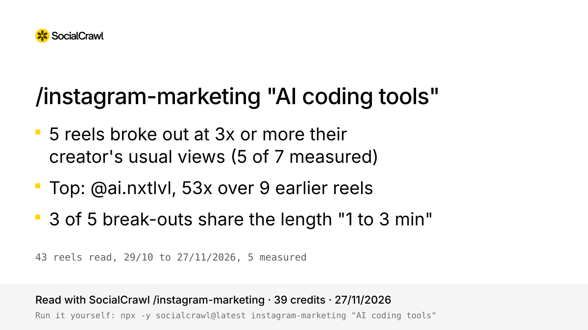

# socialcrawl-instagram-marketing

Give it a keyword. It reads Instagram's reels on it and tells you:

- which reels broke out, measured against each creator's own earlier reels;
- what the break-outs did: length, hook, music, hashtags, posting hour;
- what people ask and complain about in the comments, quoted;
- what the top reel says in its first seconds;
- what will not copy for a smaller account, and what to try next.

It only reads data, and never posts, likes, follows or comments for you.

## Install

```bash
npx -y socialcrawl@latest init
```

`init` asks for your SocialCrawl key, or signs you in by email (100 free credits, no card), and installs the skill into the agents it finds. Then ask your agent "what's working in Instagram reels for home workouts?", or run it in a terminal:

```bash
npx -y socialcrawl@latest instagram-marketing "home workouts"
```

If your keyword means something else outside your field, add one sentence: `--about "workouts people do at home without a gym"`. Only reels about that are kept.

It reads the last 30 days unless you say otherwise: `--since 2026-11-01 --until 2026-11-15` for a window of your own, or `--since 2000-01-01` for every reel the search finds, old hits included.

## Example

`instagram-marketing "AI coding tools"`, run on 27/11/2026:



The full report is in [examples/report.md](examples/report.md). In short, over 29/10 to 27/11/2026: all 5 reels measured broke out at 3 times or more their creator's usual views, out of 7 found in the window above 1,000 views. The largest, @ai.nxtlvl's, had 424,044 views against a median of 7,927 over its 9 earlier reels; three of the five ran 1 to 3 minutes. The 15 comments read on the top reel held no question or complaint the labels could find. A run folder also holds `report.html` with charts, `data/` with every reel and comment as CSV, and `responses.jsonl` with every API response.

The example names only accounts with 10,000 followers or more and links no one else's reels; your own run keeps every link in `data/posts.csv`.

## What it costs

| Run | Reads | Credits |
| --- | --- | --- |
| Default | 2 search pages cut to the last 30 days, follower counts for the 6 most viewed creators and up to 5 break-outs' creators, 6 creators measured, 1 comment section, 1 transcript | 39 measured, quoted at about 42, at most 60 |
| `--deep` | 2 undated and 2 dated search pages (with view counts), 30 follower counts, 15 creators, 6 comment sections of 2 pages, 3 transcripts | 167 measured, quoted at about 183, at most 240 |

The run prints its price, then runs. If your balance is short, it reads what the balance covers and says what it left out.

Measured 27/11/2026 on "AI coding tools", 29/10 to 27/11/2026, uncached: default 39 credits, 18 calls, 104 s (req-4jVKL3bqC4PPQ8YR to req-kyccET91LcJxiuqK); `--deep` 167 credits, 44 calls, 302 s (req-2X4l8NL9RPw838cQ to req-qAkBWhPSvURJXiZo), 29 of them on the dated search that fills view counts.

## How it measures a reel

A reel's views are divided by the median views of the same creator's 8 to 20 reels published before it, the reel itself left out. Under 8 earlier reels it gives no number. 3 times or more is a break-out. Instagram's search shows no follower counts, so the run reads them for the most viewed creators (1 credit each) and reads creators in order of views over followers, as the TikTok workflow does. Busy creators post daily, so a short baseline reads up to three more pages to reach the reels before the candidate. The default search sends no date window, because on Instagram a dated search returns reels without their view counts unless each one is paid for; the reels are cut to the window by date instead. `--deep` adds the dated search and pays for the view counts.

## What it cannot read

- Who shared a reel: Instagram has no list of reposters.
- Creators beyond the 6 measured (15 with `--deep`): their reels are listed without a multiple.
- Follower counts of creators outside the most viewed 8: those accounts are described, not named.
- Music: Instagram's search gives none. The run takes a reel's music from its own row on its creator's reel list, so only reels whose creators were measured show music, and only licensed tracks, because Instagram names no original audio there.
- Reels posted before the window: they are counted and left out; `--since 2000-01-01` reads all time.
- Whether a post was paid for: Instagram does not say, and the report never calls an account paid.

## What it calls

SocialCrawl's API only (`instagram/search/reels`, `instagram/profile`, `instagram/profile/reels`, `instagram/post/comments`, `instagram/media/transcript`), with your key. No other service.

## Code

The workflow's code and tests are in [socialcrawl/cli](https://github.com/socialcrawl/cli) under `src/workflows/instagram-marketing/` and `src/workflows/_video/`.
