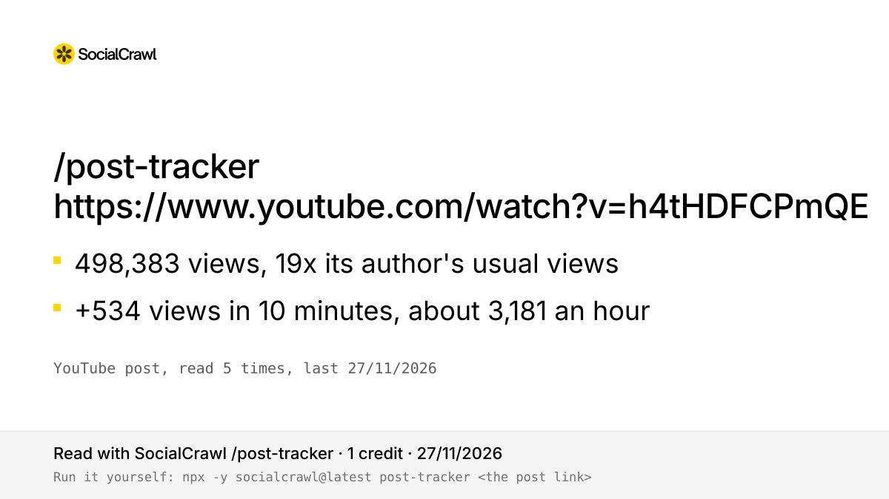

# socialcrawl-post-tracker

Give it a link to one post on X, TikTok, Instagram, YouTube or Reddit. It tells you:

- the post's views, likes, comments, shares and quotes (X) right now;
- how far it is above or below its author's usual reach (on Reddit, its community's);
- how much it gained between readings, in a table and a chart.

Each run adds a reading, so running it again later builds the post's curve. It only reads data, and never posts, likes, follows or comments for you.

## Install

```bash
npx -y socialcrawl@latest init
```

`init` asks for your SocialCrawl key, or signs you in by email (100 free credits, no card), and installs the skill into the agents it finds. Then paste a link to your agent with "track this post", or run it in a terminal:

```bash
npx -y socialcrawl@latest post-tracker "https://www.youtube.com/watch?v=h4tHDFCPmQE"
```

Run the same command again from the same folder to add a reading. For several readings in one go, add `--every 60 --times 6` (six readings an hour apart; the command stays open). For a curve over days, schedule the plain command with cron or Task Scheduler.

## Example

`post-tracker` on IBM Technology's "Vibe Coding vs. Agentic Coding" video, five readings on 27/11/2026 across four runs:



The full report is in [examples/report.md](examples/report.md). In short: the video had 498,383 views, 19 times IBM Technology's usual views (a median of 26,778 over its 20 videos before it, 30/10 to 22/11/2026). It gained 534 views in the 10 minutes the readings span, so the hourly figure is only a rough rate. The history file kept the baseline and the channel's size, so the later runs cost 1 credit each.

## What it costs

| Run | Reads | Credits |
| --- | --- | --- |
| First run on a post | the post, its author's earlier posts, and the author's size where the post read gives none (YouTube, Instagram) | 2 to 5 |
| Every later run | the post | 1 |
| `--every <minutes> --times <n>` | the post n times | about n |

There is no deeper read of one post: `--deep` reads the same calls as a default run and only raises the budget. For more readings, use `--times`.

The run prints its price, then runs. If your balance is short, it takes the readings the balance covers and says how many it left out.

Measured 27/11/2026, uncached: the IBM Technology video, 3 credits for two readings with the baseline (req-3XEl0ykdcIxJuJco, req-othyuLkC6FENfQkZ), then 2 with the one-time size read (req-2HyzteDQ65Uio4Yb), then 1 a run (req-tDTAzekAaaABKEoi, req-zYTM7hlAMx44jdgP); an r/linux thread, 2 credits for a reading and its community's baseline.

## How it measures a post

The multiple is the latest reading's views (score on Reddit) over the median of the author's 8 to 20 comparable posts published before this one, read on the first run and kept; under 8 such posts it gives no number. On Reddit the baseline is the community's top posts of the month, since votes belong to the community. The gain is the difference between the first and the latest reading, with the span between them; the rate per hour divides one by the other.

## What it cannot read

- Why a post moved: the readings show how it changed, not what caused it.
- Quotes outside X: the other platforms publish no quote count.
- Readings it did not take: a post's curve has only the points you ran it at.
- A baseline for an author with fewer than 8 earlier posts on the pages read.

## What it calls

SocialCrawl's API only (`twitter/tweet`, `tiktok/post`, `instagram/post`, `youtube/video`, `reddit/post`, and once per post the author's posts: `twitter/search/tweets`, `tiktok/profile/videos`, `instagram/profile/reels`, `youtube/channel/videos` or `youtube/channel/shorts`, `reddit/subreddit`, and `youtube/channel` or `instagram/profile` for the size), with your key. No other service.

## Code

The workflow's code and tests are in [socialcrawl/cli](https://github.com/socialcrawl/cli) under `src/workflows/post-tracker/`.
