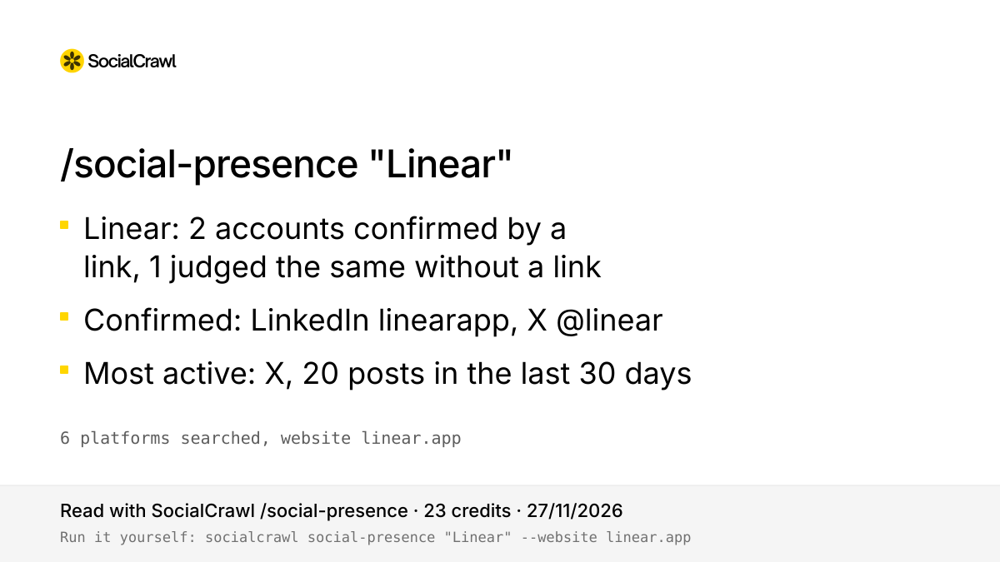

# socialcrawl-presence

Give it a brand's or a public figure's name, and its website if you have it. It searches LinkedIn, Instagram, TikTok, X, Threads and YouTube and tells you, for each platform:

- the account a link confirms: the official site in its website field, the site named on its profile, or a link between the accounts;
- an account judged the same from its name and bio but with no link, marked as not confirmed;
- weaker candidates, and the platforms where nothing matched;
- how active each account is: its last post, its posts in the last 30 days, its median reach.

A matching name or handle is never enough to call an account the brand's own, and the report says plainly when no account is confirmed. It reads public profiles and posts only, and is meant for brands, companies, creators and public figures, not private people.

## Install

```bash
npx -y socialcrawl@latest init
```

`init` asks for your SocialCrawl key, or signs you in by email (100 free credits, no card), and installs the skill into the agents it finds. Then ask your agent "where is Linear on social media?", or run it in a terminal:

```bash
npx -y socialcrawl@latest social-presence "Linear" --website linear.app
```

Add `--type person` for a person's name.

## Example

`social-presence "Linear" --website linear.app`, run on 27/11/2026:



The full report is in [examples/report.md](examples/report.md). In short: two accounts are confirmed by a link: LinkedIn `linearapp`, whose profile names linear.app, and X `@linear`, which has linear.app in its website field. The search also accepted YouTube `@linear` on its name and bio, but nothing links it to the site or the other accounts, so the report marks it "judged the same, not linked". Instagram and Threads had only weaker candidates, and TikTok none. On X, `@linear` posted 20 times in the 30 days before the run; its last post was on 25/11/2026.

## What it costs

| Run | Reads | Credits |
| --- | --- | --- |
| Default | the name search on six platforms, priced for free first; one page of recent posts for each confirmed or judged account | 23 measured, quoted at about 24, at most 43 |

If the run's budget no longer covers the search's quote, the run does not search and says so.

Measured 27/11/2026 on "Linear" with `--website linear.app`, uncached: 23 credits, 4 calls, 15 s (req-H96y76ftuyi2LfEj to req-CN4jlOWo260KWKKD).

## How it decides

The search ranks up to 5 candidates on each platform and judges the best one. This workflow then sorts that match by its evidence. Confirmed needs a link: the official site in the account's website field, the site's domain on its profile, or a link to or from the brand's other accounts. A match the search accepted on name and bio alone is "judged the same, not linked". A fan or parody account is never confirmed. An account that is not confirmed is named only from 10,000 followers or with a verified badge; otherwise the report describes it, since a name search can find a namesake.

## What it cannot read

- A LinkedIn company's posts: they need the company's numeric id, which a name search does not give. Its profile match is still reported.
- Accounts the search did not rank: a brand with an unusual handle on a platform may need its handle checked by hand.
- Who runs an account: a link shows the account belongs with the site, not who posts on it.
- Private accounts: they are never listed.

## What it calls

SocialCrawl's API only (`utility/estimate` for the free quote, `prism/find-accounts`, then `twitter/user/tweets`, `tiktok/profile/videos`, `instagram/profile/posts`, `youtube/channel/videos`, `threads/user/posts` or `linkedin/profile/posts` for recent posts), with your key. No other service.

## Code

The workflow's code and tests are in [socialcrawl/cli](https://github.com/socialcrawl/cli) under `src/workflows/social-presence/`.
