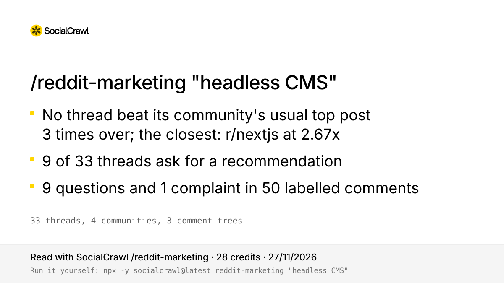

# socialcrawl-reddit-marketing

Give it a keyword. It reads the month's Reddit threads on it and tells you:

- which threads beat their own community's usual top post;
- what people ask and complain about in the comments, quoted;
- each community's size and its rule on promotion;
- the recent threads where someone asks for a tool like yours, with the rule to read before you reply.

It reads only. It never posts, votes or replies for you.

## Install

```bash
npx -y socialcrawl@latest init
```

`init` asks for your SocialCrawl key, or signs you in by email (100 free credits, no card), and installs the skill into the agents it finds. Then ask your agent "what does Reddit say about headless CMS?", or run it in a terminal:

```bash
npx -y socialcrawl@latest reddit-marketing "headless CMS"
```

If your keyword means something else outside your field, add one sentence: `--about "invoicing software for freelancers"`. Only threads about that are kept.

## Example

`reddit-marketing "headless CMS"`, run on 27/11/2026:



The full report is in [examples/report.md](examples/report.md). In short: no thread beat its community's usual top post three times over; the closest, a question in r/nextjs, sat at 2.67 times the median of the month's earlier top posts there. 9 of 33 threads asked for a recommendation, and 3 of the 4 communities read limit promotion in their rules. A run folder also holds `report.html` with charts, `data/` with every thread and comment as CSV, and `responses.jsonl` with every API response.

The example drops the links to members' posts; your own run keeps them.

## What it costs

| Run | Reads | Credits |
| --- | --- | --- |
| Default | the month's top threads and this week's new ones, 4 communities, 3 comment trees | 28 measured, quoted at about 29, at most 38 |
| `--deep` | a year of threads, 8 communities, 8 comment trees | 67 measured, quoted at about 76, at most 106 |

The run prints its price, then runs. If your balance is short, it reads what the balance covers and says what it left out.

Measured 27/11/2026 on "headless CMS", uncached, with the topic filter's judging billed: default 28 credits, 13 calls, 50 s (req-pUASDT3HdJTCfnIS to req-7wupqLjDG6v4MuAK); deep 67 credits, 26 calls, 71 s (req-9BihzRrbIy5QX72Z to req-NfKO9ZeNpwvAdOJt).

## How it measures a thread

Reddit's score belongs to a community: 30 votes is a lot in a small community and nothing in a big one. So each thread is measured against the median score of its own community's top posts of the month that came before it, with the thread left out. Under 8 such posts it gives no number. 3 times or more is a break-out; 1.5 to 3 times is above usual. That bar is high on purpose, since those are the month's best posts.

## What it cannot read

- Views: Reddit publishes none, so score and comments are the only reach there is.
- Replies below the top level of a comment tree come back without labels. They are kept in `data/comments.csv` but not counted as questions or complaints.
- Communities outside the leading four (eight with `--deep`) are not measured. Their threads are listed without a multiple.
- Some communities' rules are not reported by the source. The report says so; it does not mean there are none.
- Reddit's comment count includes removed comments, so a thread can show more comments than a run returns.

## What it calls

Only the SocialCrawl API: `reddit/search`, `reddit/subreddit/details`, `reddit/subreddit` and `reddit/post/comments`. The code is in [socialcrawl/cli](https://github.com/socialcrawl/cli/tree/main/src/workflows/reddit-marketing).
