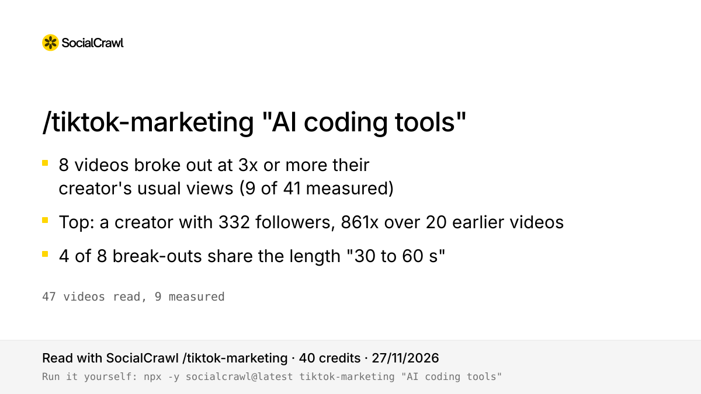

# tiktok-marketing

Give it a keyword. It reads TikTok's videos on it and tells you:

- which videos broke out, measured against each creator's own earlier videos;
- what the break-outs did: length, hook, sound, hashtags, posting hour;
- what people ask and complain about in the comments, quoted;
- what the top video says in its first seconds;
- what will not copy for a smaller account, and what to try next.

It only reads data, and never posts, likes, follows or comments for you.

## Install

```bash
npx -y socialcrawl@latest init
```

`init` asks for your SocialCrawl key, or signs you in by email (100 free credits, no card), and installs the skill into the agents it finds. Then ask your agent "what's working on TikTok for meal prep?", or run it in a terminal:

```bash
npx -y socialcrawl@latest tiktok-marketing "meal prep"
```

If your keyword means something else outside your field, add one sentence: `--about "cooking meals ahead for the week"`. Only videos about that are kept.

It reads the last 30 days unless you say otherwise: `--since 2026-11-01 --until 2026-11-15` for a window of your own, or `--since 2000-01-01` for every video the search finds, old hits included.

## Example

`tiktok-marketing "AI coding tools"`, run on 27/11/2026:



The full report is in [examples/report.md](examples/report.md). In short, over 29/10 to 27/11/2026: all 6 videos measured broke out at 3 times or more their creator's usual views, out of 35 found above 1,000 views. The largest, from @jameseer33, had 1,130,139 views against a median of 2,270 over its 11 earlier videos, which were posted three weeks before it, so the report prints each baseline's dates beside its multiple. Three of the six ran 30 to 60 seconds. The 149 comments read held 47 questions and 6 complaints. A run folder also holds `report.html` with charts, `data/` with every video and comment as CSV, and `responses.jsonl` with every API response.

The example names only accounts with 10,000 followers or more and links no one else's videos; your own run keeps every link in `data/posts.csv`.

## What it costs

| Run | Reads | Credits |
| --- | --- | --- |
| Default | two searches of the last 30 days (top and most liked), 8 creators measured, 3 comment sections, 1 transcript | 38 measured, quoted at about 41, at most 55 |
| `--deep` | three searches of 3 pages, 15 creators, 8 comment sections of 2 pages, 3 transcripts | 109 measured, quoted at about 124, at most 176 |

The run prints its price, then runs. If your balance is short, it reads what the balance covers and says what it left out.

Measured 27/11/2026 on "AI coding tools", 29/10 to 27/11/2026, uncached: default 38 credits, 15 calls, 55 s (req-XUaco9O4zmXOHi0G to req-siue0xM3hIyvOUJb); `--deep` 109 credits, 29 calls, 193 s (req-5JifQsq2tMOWNEIh to req-v52mo0yLhtJYM2Az).

## How it measures a video

Every search asks TikTok for the window (this month, by default) and every video is then cut to the exact dates, so a break-out is a video posted in the window. A video's views are divided by the median views of the same creator's 8 to 20 videos published before it, the video itself left out. Under 8 earlier videos it gives no number. 3 times or more is a break-out. Creators are read in order of views over followers, where a break-out is likeliest. In a window longer than 60 days, videos from the last 60 go first, because a creator's newest pages can still reach the videos before them. A short baseline reads up to two more pages. The rest are listed as not measured. A trait such as a length band is reported as a count among break-outs and the rest; it is called a pattern only with 24 or more settled videos to compare.

## What it cannot read

- Who shared a video: TikTok has no list of reposters.
- Creators beyond the 8 measured (15 with `--deep`): their videos are listed without a multiple.
- A creator whose pages hold fewer than 8 videos before the candidate gets no multiple.
- Comments that come back without labels are kept in `data/comments.csv` but not counted as questions or complaints.
- Videos posted before the window: they are counted and left out; `--since 2000-01-01` reads all time.
- Whether a post was paid for: TikTok does not say, and the report never calls an account paid.

## What it calls

SocialCrawl's API only (`tiktok/search`, `tiktok/profile/videos`, `tiktok/post/comments`, `tiktok/post/transcript`), with your key. No other service.

## Code

The workflow's code and tests are in [socialcrawl/cli](https://github.com/socialcrawl/cli) under `src/workflows/tiktok-marketing/` and `src/workflows/_video/`.
