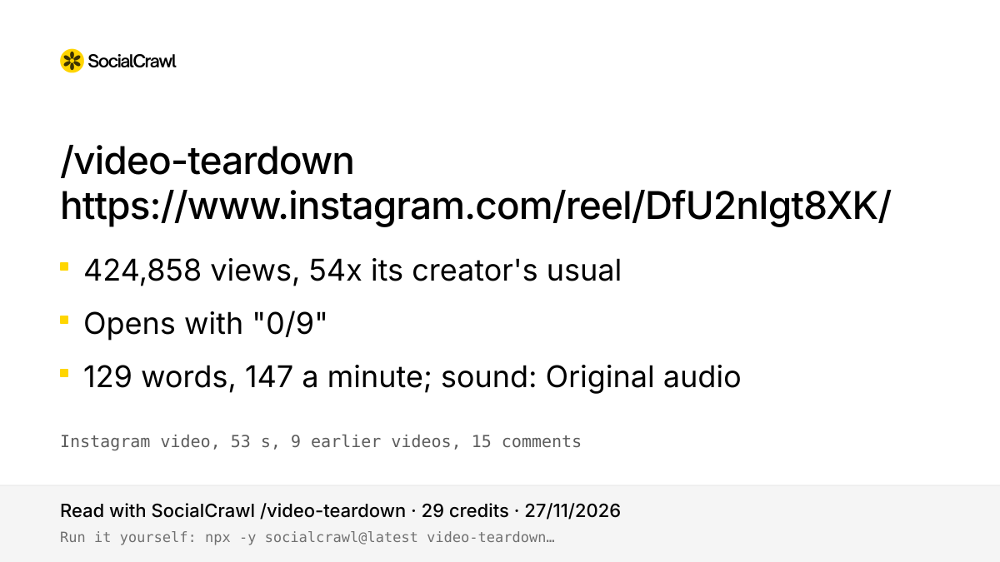

# video-teardown

Give it one video link from TikTok, YouTube, Instagram or X. It tells you:

- how the video did against its creator's own earlier videos, as a multiple of their usual views;
- a storyboard: what is on screen and what is said, in the same time windows;
- the hook: what is on screen and said in the first 3 seconds;
- its words, its pace and its sound;
- what the comments ask and complain about, quoted.

It reads public data only. It never downloads the video, and never posts, likes, follows or comments for you.

## Install

```bash
npx -y socialcrawl@latest init
```

`init` asks for your SocialCrawl key, or signs you in by email (100 free credits, no card), and installs the skill into the agents it finds. Then ask your agent "break down this video: <link>", or run it in a terminal:

```bash
npx -y socialcrawl@latest video-teardown https://www.instagram.com/reel/DfU2nIgt8XK/
```

## Example

`video-teardown https://www.instagram.com/reel/DfU2nIgt8XK/`, run on 27/11/2026:



The full report is in [examples/report.md](examples/report.md). In short: the reel had 424,858 views, 54 times @ai.nxtlvl's usual (a median of 7,928 over its 9 reels before it). Its first second puts eight app logos and the word "PAID" on screen, and its first spoken sentence is "Stop paying for these nine apps." Then, app by app, the screen shows the app's name with a question mark, the free GitHub repository that replaces it and its stars. It ends on a comments screen ("send you all 9"). The transcript has 129 words, 147 a minute. Instagram's transcript has no times, so the storyboard is built from the on-screen text alone.

## What it costs

| Platform | Reads | Credits, measured |
| --- | --- | --- |
| Instagram | the reel, its creator's size and earlier reels, on-screen text, words, comments | 29 (quoted at about 28, at most 29) |
| TikTok | the video, its creator's earlier videos, on-screen text, words, comments | 21 (about 25) |
| X | the post, its author's earlier originals, words, replies | 14 (about 14) |
| YouTube | the video, its channel's size and earlier videos, words, comments | 7 (about 6, at most 7) |

`--deep` reads three pages of comments instead of one. The run prints its price, then runs.

Measured 27/11/2026, uncached, one video each: Instagram 29 credits, 6 calls, 39 s (req-a66R7tLFdLvSOzqg to req-Lm6S9VuekmQgOE3R); TikTok 21, 6 calls, 16 s (req-pwz2JlGbkmxlzNAk to req-sSCNTZWu4VvR1G3Q); YouTube 7, 5 calls, 9 s (req-tKXpxFNbcvsBIHlj to req-4hgGyyO2e1HzFolW); X 14, 5 calls, 15 s (req-vR3mIMY61NS0c6Aw to req-oGBIOsjpoYgRstuO).

## How it counts

The multiple is the video's views over the median views of its creator's earlier comparable videos published before it. If the first pages of the creator's feed hold fewer than 8 earlier videos, it reads up to two more pages. Under 8, or with a median under 100 views, no multiple is given.

The storyboard comes from two reads. On-screen text is what the API reads off the frames, by the second, on TikTok and Instagram; the whole video is read up to 180 seconds, and only the cover of a longer one. Spoken words come from the transcript, which has times on TikTok and YouTube. A column whose source has no times is left out rather than guessed.

## What it cannot read

- The picture itself: shots, cuts, faces and motion are not measured, only the text on screen and the words.
- On-screen text on YouTube and X: neither gives frames here.
- When words are said on Instagram and X: their transcripts have no times.
- On-screen text after the cover on a TikTok or Instagram video longer than 180 seconds.
- What each beat is for (hook, proof, call to action): that is a reading of the storyboard, and the skill tells your agent to mark it as inferred.

A creator under 10,000 followers is described, not named, and their link stays in `data/post.csv`. Commenters are never named.

## What it calls

SocialCrawl's API only (`tiktok/post`, `tiktok/profile/videos`, `tiktok/video/screen-text`, `tiktok/post/transcript`, `tiktok/post/comments`, `instagram/post`, `instagram/profile`, `instagram/profile/reels`, `instagram/media/screen-text`, `instagram/media/transcript`, `instagram/post/comments`, `youtube/video`, `youtube/channel`, `youtube/channel/videos`, `youtube/channel/shorts`, `youtube/video/transcript`, `youtube/video/comments`, `twitter/tweet`, `twitter/search/tweets`, `twitter/tweet/transcript`, `twitter/tweet/replies`), with your key. No other service.

## Code

The workflow's code and tests are in [socialcrawl/cli](https://github.com/socialcrawl/cli) under `src/workflows/video-teardown/`.
