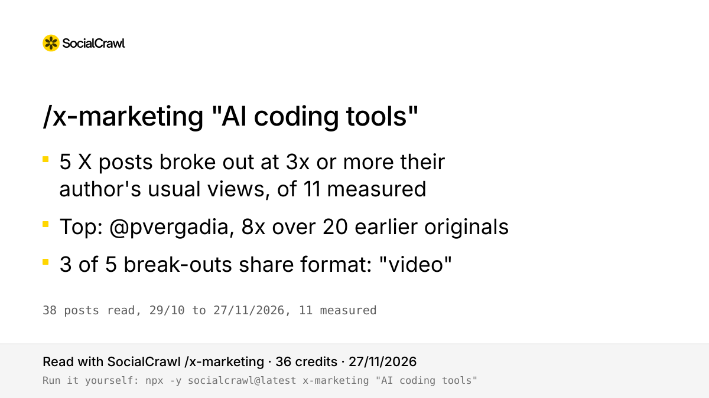

# x-marketing

Give it a keyword. It reads the X posts about it from the last 30 days and tells you:

- which posts broke out, each measured against its author's own earlier posts;
- who carried the top ones: their retweeters, and the quotes it can find;
- which posts look boosted rather than organic, marked as inferred and left out of the break-outs;
- what the replies ask and complain about, quoted;
- what to try next.

It only reads data, and never posts, likes, retweets, follows or replies for you.

## Install

```bash
npx -y socialcrawl@latest init
```

`init` asks for your SocialCrawl key, or signs you in by email (100 free credits, no card), and installs the skill into the agents it finds. Then ask your agent "what's working on X for AI coding tools", or run it in a terminal:

```bash
npx -y socialcrawl@latest x-marketing "AI coding tools"
```

If your keyword means something else outside your field, add `--about` with one sentence, for example `--about "content management systems for developers"`. It reads the last 30 days unless you pass `--since` and `--until`; `--since 2000-01-01` reads all time.

## Example

`x-marketing "AI coding tools"`, run on 27/11/2026:



The full report is in [examples/report.md](examples/report.md). In short, over 29/10 to 27/11/2026: 5 of the 11 posts that could be measured broke out at 3 times or more their author's usual views. The largest, from @pvergadia, had 18,395 views against a median of 2,291 over its author's 20 earlier posts, 8 times the usual. Three of the five were videos, against two of the six that did not break out. The quote search found 14 quotes of @ZaraAi56190's post, the first ten hours after it went up. The replies held 4 questions and 2 complaints.

The example names only accounts with 10,000 followers or more; your own run keeps every link in `data/posts.csv`.

## What it costs

| Run | Reads | Credits |
| --- | --- | --- |
| Default | two pages of top posts and one of the latest, the earlier posts of up to 12 authors, retweeters and quotes on the top break-outs, replies on three | 36 measured, quoted at about 35, at most 55 |
| `--deep` | four pages of top posts and two of the latest, more candidates for the same 12 authors, retweeters on six posts, quotes on six, replies on eight | 58 measured, quoted at about 88, at most 128 |

The run prints its price, then runs. If your balance is short, it reads what the balance covers and says what it left out.

Measured 27/11/2026 on "AI coding tools", 29/10 to 27/11/2026, uncached: default 36 credits, 22 calls, 79 s (req-Er9DJhuIdcfxnl2R to req-q5ZKbKM7Oxy5DWVG); `--deep` 58 credits, 35 calls, 183 s (req-RlPGc72Ex9sFOgUd to req-XfRJUtQJHuVHpOxb).

## How it counts

Each post is divided by the median views of its author's 8 to 20 original posts published before it (no replies, no retweets), read with one search that ends at the minute the post went up. 3 times or more is a break-out. Under 8 earlier posts, or a median under 100 views, no multiple is given.

A post is marked likely boosted (inferred) only when two things hold together: under 1.5 likes per 1,000 views, and more than 12% of the retweeters read above 10,000 followers. Such a post is never called a break-out. With few likes per view alone it is marked unusual engagement (inferred) and kept. Neither mark says a post was paid for, because X publishes no ad flag the run can read.

## What it cannot read

- Every quote: the quote search finds about two thirds of a post's quotes.
- Every retweeter: one page is read per post, two on `--deep`.
- Posts under 1,000 views: they are counted, not measured.
- More than 12 authors: the run reads the earlier posts of the 12 whose posts drew the most views per follower, on either kind of run, and the report counts the posts it could not measure.

## What it calls

SocialCrawl's API only (`twitter/search/tweets`, `twitter/tweet/retweeters`, `twitter/tweet/replies`), with your key. No other service.

## Code

The workflow's code and tests are in [socialcrawl/cli](https://github.com/socialcrawl/cli) under `src/workflows/x-marketing/`.
