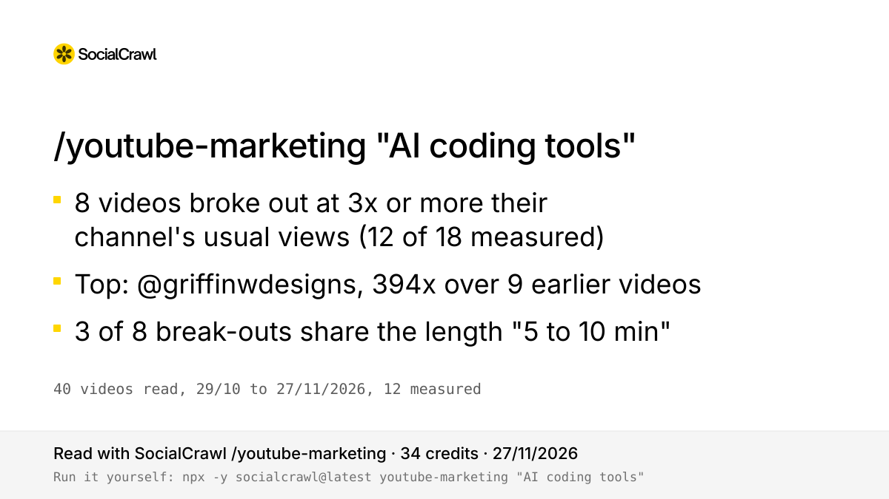

# youtube-marketing

Give it a keyword. It reads YouTube's videos and Shorts on it and tells you:

- which broke out, measured against each channel's own earlier uploads, Shorts against Shorts and long videos against long videos;
- what the break-outs did: length, title, hashtags, posting hour;
- what people ask and complain about in the comments, quoted;
- what the top videos say in their first seconds;
- what will not copy for a smaller channel, and what to try next.

It only reads data, and never posts, likes, subscribes or comments for you.

## Install

```bash
npx -y socialcrawl@latest init
```

`init` asks for your SocialCrawl key, or signs you in by email (100 free credits, no card), and installs the skill into the agents it finds. Then ask your agent "what's working on YouTube for home espresso?", or run it in a terminal:

```bash
npx -y socialcrawl@latest youtube-marketing "home espresso"
```

If your keyword means something else outside your field, add one sentence: `--about "making espresso at home"`. Only videos about that are kept.

## Example

`youtube-marketing "AI coding tools"`, run on 27/11/2026:



The full report is in [examples/report.md](examples/report.md). In short: 7 of the 8 videos measured broke out at 3 times or more their channel's usual views, out of 43 found above 1,000 views. The largest was a Short from a channel with 3,430 subscribers: 559,006 views against a median of 548 over its 20 Shorts before it, all from 2023, so it is an old hit, as the dates beside the multiple show. Among channels big enough to name, @insiderforce's video reached 205 times its median. The 300 comments read held 28 questions and 8 complaints. A run folder also holds `report.html` with charts, `data/` with every video and comment as CSV, and `responses.jsonl` with every API response.

The example names only channels with 10,000 subscribers or more and links no one else's videos; your own run keeps every link in `data/posts.csv`.

## What it costs

| Run | Reads | Credits |
| --- | --- | --- |
| Default | two searches (videos and Shorts), one batch lookup of likes and durations, one of subscribers, 10 channel shelves, 3 comment sections, 2 transcripts | 41 measured, quoted at about 33, at most 49 |
| `--deep` | three searches of 3 pages, 25 channel shelves of 2 pages, 8 comment sections of 2 pages, 5 transcripts | quoted at about 119, at most 156; not yet measured |

The run prints its price, then runs. If your balance is short, it reads what the balance covers and says what it left out.

Measured 27/11/2026 on "AI coding tools", uncached: default 41 credits, 26 calls, 224 s (req-JShBZ0ZM68kkInHj to req-1DVC4CW36HIgNr2S). It cost more than the quote's expected figure because most channel shelves needed a second page; it stayed under the quote's ceiling.

## How it measures a video

A video's views are divided by the median views of the same channel's 8 to 20 uploads of the same kind published before it: a Short against the channel's Shorts shelf, a long video against its Videos tab, the video itself left out. Under 8 earlier uploads it gives no number. 3 times or more is a break-out. Search Shorts carry no channel, so one batch lookup fills each video's channel, likes and duration, and a second gives each channel's subscriber count. Channels are read in order of views: views over subscribers was a poor guide to a channel's own median when measured.

## What it cannot read

- Who shared a video: YouTube has no list of who shared it.
- Channels beyond the 10 measured (25 with `--deep`): their videos are listed without a multiple.
- Sound: YouTube rows carry no music, so the sound table stays empty.
- Sponsorship: the report does not read YouTube's paid-promotion flag and never calls a channel paid.

## What it calls

SocialCrawl's API only (`youtube/search`, `youtube/videos`, `youtube/channels`, `youtube/channel/videos`, `youtube/channel/shorts`, `youtube/video/comments`, `youtube/transcripts`), with your key. No other service.

## Code

The workflow's code and tests are in [socialcrawl/cli](https://github.com/socialcrawl/cli) under `src/workflows/youtube-marketing/` and `src/workflows/_video/`.
